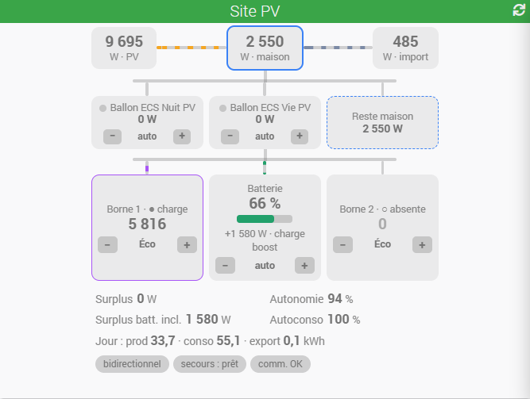
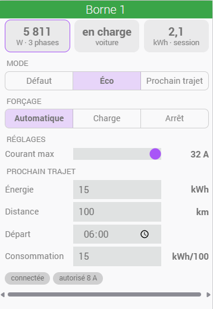
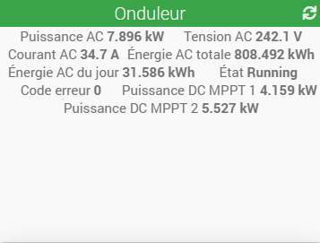
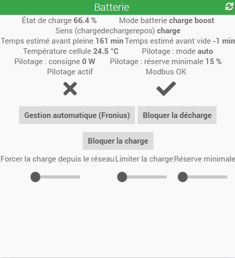

# MyFronius — Documentation

## Présentation

**MyFronius** relie votre installation photovoltaïque **Fronius** à Jeedom : il lit l'onduleur, le Smart Meter et la batterie en quasi temps réel, en calcule ce qui compte pour piloter une maison solaire, et peut agir lui-même sur vos consommateurs, sur la batterie et sur vos bornes de recharge Fronius Wattpilot.

Le plugin s'adresse avant tout à celles et ceux qui veulent **tirer parti de leur surplus solaire** plutôt que de l'injecter : chauffe-eau, pompe de piscine, radiateur, recharge de la voiture. Il fournit des valeurs fiables et lissées pour vos scénarios, et peut se charger lui-même de l'essentiel sans scénario.

### Ce que fait le plugin

- **Lecture de l'installation** par la Solar API Fronius : les quatre flux de puissance du site (production, maison, réseau, batterie), le **surplus disponible** et le surplus batterie incluse, des **tendances** (moyennes 1 / 5 / 15 min et pente) pour décider sans yo-yo, les **énergies du jour** avec les taux d'autoconsommation et d'autonomie, l'état détaillé de la batterie, les mesures de chaque onduleur et de chaque Smart Meter. Les équipements et leurs commandes sont créés automatiquement selon ce qui est détecté.
- **Charges pilotées sur le surplus**, sans scénario : vous désignez les commandes Jeedom d'un appareil (de n'importe quel plugin) et le plugin l'allume et l'éteint selon le surplus, avec priorités, délais, durées minimales, prise en compte de la batterie et formule d'autorisation.
- **Pilotage de la batterie** par Modbus TCP (optionnel) : bloquer la décharge pour la soirée, bloquer la charge pour laisser le surplus aux consommateurs, forcer une charge en heures creuses, régler la réserve minimale.
- **Bornes Fronius Wattpilot** : état en direct, changement de mode (Défaut, Éco, Prochain trajet), forçage, et réglages depuis Jeedom (courant maximal, énergie ou distance du prochain trajet, heure de départ, consommation du véhicule).
- **Widgets dédiés** pour le Site PV et pour chaque borne, sur le dashboard et le mobile.

| Widget Borne | Widget Onduleur |
|---|---|
|  |  |

### Compatibilité

| Matériel | Support |
|----------|---------|
| **Onduleurs Fronius** | Tout onduleur exposant la **Solar API V1** : GEN24 (Symo, Primo, Verto), SnapINverter (Symo, Primo, Symo Hybrid…). Plusieurs onduleurs sur le même Datamanager sont gérés. |
| **Smart Meter** | Smart Meter Fronius déclaré dans l'onduleur (au point d'injection ou en branche consommation), un ou plusieurs. Sans Smart Meter, les énergies réseau du jour sont estimées. |
| **Batterie** | Toute batterie vue par l'onduleur dans la Solar API (Fronius Reserva, BYD HVS/HVM…). Le pilotage demande en plus le Modbus TCP SunSpec de l'onduleur (GEN24, Symo Hybrid). |
| **Bornes de recharge** | **Fronius Wattpilot** (Go, Home, Flex) uniquement à ce jour, voir ci-dessous. |
| **Jeedom** | Version 4.4 ou supérieure, Atlas, Luna, Raspberry Pi, Docker, DIY (Debian 11 / 12). |

**Bornes de recharge : orienté Wattpilot.** Les bornes ne sont pas visibles par la Solar API : le plugin dialogue directement avec chaque Wattpilot par le protocole de l'application Wattpilot.Solar, ce qui lui donne l'état en direct et les ordres (mode, forçage, réglages). Ce protocole est propre aux Wattpilot (et aux go-e Charger dont elles dérivent, non testés). **Aucune autre marque de borne n'est prise en charge pour l'instant.** Une extension à d'autres bornes reste envisageable à l'avenir, selon la faisabilité technique (protocole ouvert ou documenté, borne disponible pour les tests) et les retours des utilisateurs : si vous êtes intéressé, dites-le sur le fil Community du plugin en précisant le modèle. En attendant, une borne pilotable par un autre plugin peut être traitée comme une **charge pilotée** (marche / arrêt sur le surplus, sans réglage du courant).

### Installation de référence

Le plugin est développé et testé sur une installation composée d'un onduleur **Symo GEN24** avec une batterie **Fronius Reserva**, un **Smart Meter** au point d'injection et deux **Wattpilot Flex**, sur une Jeedom **Atlas**. Les autres configurations (sans batterie, sans Smart Meter, plusieurs onduleurs, SnapINverter) sont prévues par le code à partir de la documentation Fronius, mais n'ont pas pu être vérifiées sur du matériel réel : vos retours sur Community sont les bienvenus, avec le log `myfronius_daemon` en niveau debug si quelque chose ne va pas.

---

## Prérequis

- **Jeedom ≥ 4.4**
- Onduleur Fronius exposant la **Solar API V1** (GEN24, Symo, Primo, Symo Hybrid…)
- **Sur les GEN24, la Solar API doit être activée** dans l'interface web de l'onduleur : menu **Communication > Solar API**. Elle est désactivée par défaut sur les firmwares récents.
- Accès réseau local entre Jeedom et l'onduleur (même réseau LAN, port 80)
- Python 3 (installé automatiquement par Jeedom lors de l'installation du plugin)
- Pour les bornes : une ou plusieurs **Fronius Wattpilot** sur le réseau local, avec le mot de passe défini dans l'application Wattpilot.Solar
- Pour le pilotage de la batterie : le **serveur Modbus TCP** de l'onduleur activé avec « Autoriser la commande » (voir *Pilotage de la batterie*)

---

## Installation

1. Dans Jeedom, aller dans **Plugins > Gestion des plugins > Market**
2. Rechercher **MyFronius** et installer depuis le canal souhaité (beta ou stable)
3. Activer le plugin après installation
4. Configurer le plugin (voir section suivante)

---

## Configuration globale

Accessible via **Plugins > Gestion des plugins > MyFronius > Configuration** (icône engrenage).

| Paramètre | Description | Valeur par défaut |
|-----------|-------------|-------------------|
| **Adresse de l'onduleur** | Adresse IP ou nom DNS de l'onduleur sur le réseau local (`http://` ajouté automatiquement si absent) | — |
| **Cadence de lecture (s)** | Intervalle entre deux lectures de l'onduleur (5 à 60 s ; au-delà, les énergies du jour ne pourraient plus être calculées et la consigne batterie expirerait entre deux lectures) | `15` |
| **Pilotage de la batterie (Modbus TCP)** | Active l'écriture des consignes batterie ; port et unit ID Modbus en dessous | `Désactivé`, `502`, `1` |
| **Port socket démon** | Port TCP utilisé en interne par le démon Python | `55010` |
| **Pause des charges au branchement d'une voiture (s)** | Durée pendant laquelle les charges pilotées automatiques restent éteintes après le branchement d'une voiture sur une Wattpilot (0 = désactivé) | `300` |
| **Mode commandes par défaut** | Mode appliqué aux nouveaux équipements lors de la synchronisation | `standard` |

Modifier l'adresse, la cadence, le port socket ou le pilotage Modbus redémarre le démon s'il tourne, une seule fois à la fin de la sauvegarde, avec tous les paramètres enregistrés.

### Bouton « Tester la connexion »

Vérifie l'accès à l'onduleur avec les paramètres saisis et affiche la **version de la Solar API**, le **mode du site** (par exemple `bidirectional` avec une batterie), et la **présence d'un Smart Meter et d'une batterie**. **L'adresse saisie est enregistrée si le test réussit** (les autres paramètres, comme la cadence ou le port, doivent être enregistrés avec le bouton **Sauvegarder**), et le démon est démarré s'il ne tourne pas encore.

---

## Synchronisation des équipements

Depuis la liste des équipements (**Plugins > Énergie > MyFronius**), cliquer sur **Synchroniser**.

Le plugin interroge l'onduleur, détermine la structure réelle de l'installation (nombre d'onduleurs, entrées MPPT câblées, présence d'un Smart Meter, présence et état de la batterie) et crée automatiquement les équipements correspondants :

| Équipement | Description |
|------------|-------------|
| **Site PV** | Vue d'ensemble : flux de puissance, surplus, tendances, énergies du jour, taux du jour. Toujours créé. |
| **Batterie** | État de charge, mode, sens, estimations de temps, mesures électriques. Créé si une batterie est détectée. |
| **Onduleur N** | Données techniques de chaque onduleur (AC, DC par MPPT, énergie totale, état). Un équipement par onduleur. |
| **Smart Meter N** | Mesures par phase et compteurs absolus. Un équipement par Smart Meter. |
| **Borne N** | Borne Wattpilot ajoutée manuellement (bouton **Ajouter une borne**, voir plus bas). Un équipement par borne. |
| **Charge N** | Charge pilotée ajoutée manuellement (bouton **Ajouter une charge**, voir plus bas). Un équipement par charge. |

Les noms des équipements et des commandes peuvent être renommés librement : ils sont **préservés** lors des synchronisations suivantes, de même que la visibilité, l'historisation et l'ordre des commandes.

**Historisation par défaut** (posée à la création de chaque commande, jamais réimposée ensuite : vos réglages sont conservés, y compris lors d'une resynchronisation ou d'une mise à jour) :

- **Site PV** : puissances (production, maison, maison hors bornes, réseau, batterie, surplus disponible, surplus batterie incluse), surplus moyens sur 1 min (ceux sur lesquels décident les charges pilotées), bilans et taux du jour, mode du site, mode secours, communication onduleur ;
- **Batterie** : état de charge, puissance, sens, en charge, veille, température, mode batterie Fronius et, si le pilotage Modbus est activé, mode, consigne, réserve, pilotage actif, Modbus OK ;
- **Onduleur** : état, code erreur, puissance AC, puissance DC par MPPT, énergies ;
- **Smart Meter** : puissance totale, énergies importée et exportée ;
- **Bornes** : puissance, courant autorisé, phases, charge autorisée, énergies, état voiture, raison de l'état, connexion, mode, forçage et réglages (courant réglé, seuil et limite batterie du surplus, charge sur surplus, énergie, distance et heure du prochain trajet, consommation du véhicule) ;
- **Charges pilotées** : puissance, état, mode, raison, énergie du jour.

Les textes, les binaires et les puissances des bornes et des charges pilotées n'enregistrent que les changements (répétition « Non »). Les puissances instantanées sont en mode d'historisation **« Moyenne »** : chaque cycle est conservé tant que les points sont récents, puis Jeedom les réduit à une moyenne par heure au-delà du **Délai avant archivage** (Réglages → Système → Configuration, onglet **Équipements**, section « Historique des commandes » ; réglage global à tous les plugins, 2 h par défaut). **Réglez-le sur 336 h (14 jours)** pour garder le détail des deux dernières semaines, utile pour analyser la régulation. Aucune commande n'est purgée : au-delà du délai, une puissance ne pèse plus que 24 points par jour.

Sur une installation existante, le plugin **complète** ces réglages une seule fois (mise à jour ou démarrage du démon) : il active l'historisation manquante des commandes de la liste et remplit les réglages restés à leur valeur par défaut. Il ne **retire jamais** une historisation et ne remplace aucun réglage que vous avez choisi. Attention : dans Jeedom, décocher « Historiser » sur une commande efface tout son historique au prochain archivage.

Le bouton **Restaurer les défauts d'historisation** (configuration du plugin) remet au contraire **toutes** les commandes du plugin sur ces réglages, y compris ceux que vous avez modifiés : un aperçu indique combien de commandes changent et lesquelles perdraient leur historisation (donc leur historique), puis une confirmation est demandée.

Volume : pendant le délai d'archivage, une puissance à la cadence de 10 s représente jusqu'à 8 600 points par jour ; allonger le délai augmente d'autant la table d'historique de Jeedom, pour toutes les commandes historisées de la box.

Le bouton **Régénérer les commandes** d'un équipement supprime ses commandes (et leur historique) puis les recrée depuis la dernière découverte, avec de **nouveaux identifiants** : les scénarios, virtuels, designs, vues ou charges pilotées qui les utilisent sont à reconfigurer. Pour seulement recréer des commandes manquantes, **Synchroniser** suffit. Il est refusé, sans rien supprimer, si certaines commandes existantes ne pourraient pas être recréées (par exemple la température de la batterie quand le stockage était en erreur lors de la dernière découverte) : relancer **Synchroniser** une fois l'appareil revenu, puis régénérer.

Sur la fiche d'un onduleur, le **Modèle**, le **N° de série** et le **Firmware** exacts viennent du Modbus (pilotage de la batterie activé) ; une synchronisation faite démon arrêté les conserve. Sans Modbus, le modèle reste vide : la Solar API ne donne que le **Nom (onduleur)** saisi dans l'onduleur. La **Puissance crête** n'est pas renseignée sur un GEN24 (non fournie par la Solar API).

> Les équipements Site PV, Batterie, Onduleur et Smart Meter sont créés uniquement par la synchronisation ; les bornes et les charges ne le sont pas : elles s'ajoutent avec les boutons dédiés.

---

## Équipements et commandes

Les équipements Site PV, Onduleur et Smart Meter n'exposent que des commandes **info**, mises à jour à chaque cycle de lecture ; la Batterie (pilotage Modbus), les Bornes et les Charges ont aussi des commandes action. Chaque équipement porte en plus une commande action **Rafraîchir**, commune à tous : elle relance une découverte complète de l'installation (comme le bouton **Synchroniser**) suivie d'une lecture immédiate et d'un renvoi de toutes les valeurs. Les moyennes et pentes ne sont pas remises à zéro. Démon arrêté, elle ne fait que la découverte, sans relire de valeur.

Unités : puissances en **W**, énergies en **kWh** (3 décimales), pourcentages en **%**, durées en **min**, tensions en **V**, courants en **A**, température en **°C**.

### Site PV

#### Flux instantanés

| Commande | Unité | Description |
|----------|-------|-------------|
| **Production PV** | W | Puissance produite par les panneaux (toujours ≥ 0 ; 0 quand l'onduleur est à l'arrêt) |
| **Consommation maison** | W | Puissance consommée par la maison (toujours ≥ 0) |
| **Consommation maison hors bornes** | W | Consommation maison moins la puissance des bornes de recharge connectées (c'est elle qu'affiche la tuile « maison » du widget) |
| **Réseau (signé, + import)** | W | Échange avec le réseau : positif = import (soutirage), négatif = export (injection) ; 0 en mode secours (Smart Meter hors ligne) |
| **Import réseau** / **Export réseau** | W | Les deux composantes du flux réseau, chacune ≥ 0 |
| **Batterie (signé, + charge)** | W | Échange avec la batterie : positif = charge, négatif = décharge |
| **Charge batterie** / **Décharge batterie** | W | Les deux composantes du flux batterie, chacune ≥ 0 |
| **Surplus disponible** | W | Puissance actuellement **injectée dans le réseau**, donc immédiatement utilisable par un consommateur supplémentaire sans soutirer (= Export réseau) |
| **Surplus batterie incluse** | W | Surplus disponible **+ puissance de charge de la batterie** : ce qui serait disponible si l'on acceptait de ralentir la charge de la batterie au profit d'un autre usage |
| **Autonomie instantanée** | % | Part de la consommation couverte sans le réseau |
| **Autoconsommation instantanée** | % | Part de la production consommée sur place |
| **Mode site** | texte | Mode Fronius du site, en anglais (`bidirectional`, `produce-only`, `meter`, `ac-coupled`…) |
| **Mode secours actif** | binaire | L'onduleur alimente la maison en mode secours (backup) : réseau coupé, Smart Meter hors ligne. Déclencheur d'un scénario d'alerte (1 = coupure, 0 = retour du réseau). Au retour du réseau, le Smart Meter est recherché automatiquement pendant 10 minutes s'il avait disparu de la découverte |
| **Batterie en veille** | binaire | La batterie est en veille (Fronius) |
| **Communication onduleur OK** | binaire | Dernière lecture de l'onduleur réussie |
| **Dernière mise à jour** | texte | Heure locale de la dernière lecture réussie (`HH:MM:SS`) |
| **Fenêtre 15 min complète** | binaire | Les tendances sur 15 min reposent sur une fenêtre pleine (voir *Démon*) |

**Surplus disponible** est la valeur à utiliser pour déclencher un consommateur en priorité sur la batterie ; **Surplus batterie incluse** est celle à utiliser si l'on préfère consommer plutôt que charger la batterie (par exemple quand la batterie est déjà bien chargée).

#### Tendances

Pour chacune des grandeurs **Production PV**, **Consommation maison**, **Réseau**, **Batterie**, **Surplus** et **Surplus batterie incluse**, quatre commandes de tendance sont créées :

| Commande | Unité | Description |
|----------|-------|-------------|
| **… — moyenne 1 min** | W | Moyenne glissante sur la dernière minute |
| **… — moyenne 5 min** | W | Moyenne glissante sur les 5 dernières minutes |
| **… — moyenne 15 min** | W | Moyenne glissante sur les 15 dernières minutes |
| **… — pente 5 min** | W/min | Tendance d'évolution sur les 5 dernières minutes (positive = en hausse) |

Les moyennes sont pondérées par le temps réel des lectures, elles restent donc justes même si un cycle manque. Elles sont créées **non visibles** sur le dashboard (sauf la pente du surplus) pour ne pas encombrer les widgets, mais restent utilisables dans les scénarios.

Ces tendances existent pour éviter de déclencher un appareil sur un pic de production ou sur le passage d'un nuage. Dans un scénario, on préférera par exemple :

- *« Surplus — moyenne 5 min > 1500 W »* pour enclencher un chauffe-eau, plutôt que le surplus instantané ;
- *« Surplus — moyenne 15 min < 200 W »* pour l'arrêter ;
- *« Production PV — pente 5 min < −300 W/min »* pour anticiper une chute de production.

#### Énergies du jour

Toutes remises à zéro **à minuit, heure locale de Jeedom** (fuseau réglé dans la configuration de Jeedom, même si le système, par exemple un conteneur Docker, est en UTC). Les valeurs de la veille restent dans l'historique Jeedom.

| Commande | Unité | Description |
|----------|-------|-------------|
| **Production PV du jour** | kWh | Énergie produite par les panneaux depuis minuit |
| **Import réseau du jour** | kWh | Énergie soutirée au réseau depuis minuit |
| **Export réseau du jour** | kWh | Énergie injectée dans le réseau depuis minuit |
| **Consommation maison du jour** | kWh | Énergie consommée par la maison depuis minuit |
| **Charge batterie du jour** / **Décharge batterie du jour** | kWh | Énergie entrée dans / sortie de la batterie depuis minuit |
| **Autoconsommation du jour** | % | (Production − Export) / Production |
| **Autonomie du jour** | % | (Consommation − Import) / Consommation |

En mode expert s'ajoute **Énergie AC onduleur du jour** (somme des onduleurs ; ≠ production PV sur un hybride, car elle inclut la décharge de la batterie).

Deux précisions sur le mode de calcul :

- Les onduleurs **GEN24 ne fournissent pas l'énergie du jour** via la Solar API. La **production PV du jour** est donc calculée par le plugin, en intégrant la puissance PV au fil des lectures. L'écart avec la valeur affichée par Solar.web est de l'ordre du pourcent.
- L'**import** et l'**export du jour** sont calculés à partir des **compteurs absolus du Smart Meter**, ils sont donc exacts. Sans Smart Meter au point d'injection, ils sont déduits par intégration du flux réseau (moins précis). Si le Smart Meter ou l'onduleur ne répond pas sur une lecture, ou renvoie une valeur invalide (compteur à 0, valeurs signalées non valides), les énergies du jour gardent leur dernière valeur au lieu de chuter ou de sauter (y compris deux lectures aberrantes de suite, ou une première lecture du jour à 0) ; un compteur remplacé en cours de journée est détecté et l'énergie déjà comptée est conservée. À minuit, l'**énergie AC onduleur du jour** repasse à 0 même si l'onduleur ne répond pas encore (onduleur en veille la nuit).

### Batterie

| Commande | Unité | Description |
|----------|-------|-------------|
| **État de charge** | % | SOC de la batterie |
| **Mode batterie** | texte | Mode de fonctionnement tel que fourni par Fronius, **en anglais** (`normal`, `service`, `charge boost`, `nearly depleted`, `suspended`, `calibrate`, `grid support`, `deplete recovery`, `non use`, `no solar`…) |
| **Sens (charge/decharge/repos)** | texte | `charge`, `decharge` ou `repos` (seuil ±10 W) |
| **En charge** | binaire | La batterie est en train de se charger |
| **Puissance batterie (+ charge)** | W | Identique au flux batterie du site |
| **Veille** | binaire | Batterie en veille |
| **Temps estimé avant pleine** | min | Estimation à partir de la puissance de charge moyenne sur 5 min ; **−1 = non applicable** (batterie pas en charge, ou capacité inconnue) |
| **Temps estimé avant vide** | min | Estimation à partir de la puissance de décharge moyenne sur 5 min ; **−1 = non applicable** |
| **Température cellule** | °C | Température des cellules |

Le mode batterie est volontairement conservé en anglais et tel quel : c'est la valeur que l'on retrouve dans la documentation Fronius, et elle se compare directement dans un scénario.

En mode expert s'ajoutent la capacité utilisable et nominale, la tension et le courant DC, le code d'état cellule et l'indicateur « Batterie gérée ». Si l'onduleur ne répond pas sur les données de stockage, ces commandes et la température ne sont pas créées, mais l'équipement existe quand même avec le SOC, le mode, le sens et les estimations.

La capacité utilisée pour les estimations est lue sur la batterie. Si elle n'est pas disponible, un champ **Capacité (Wh)** dans la configuration de l'équipement Batterie permet de la saisir à la main ; sans capacité connue, les deux temps estimés valent −1.

### Onduleur N

| Commande | Unité | Description |
|----------|-------|-------------|
| **Puissance AC** | W | Puissance délivrée côté alternatif (sur un hybride, inclut la décharge de la batterie) |
| **Tension AC** / **Courant AC** | V / A | Mesures côté alternatif |
| **Puissance DC MPPT n** | W | Production de chaque string (une commande par entrée MPPT câblée) |
| **Énergie AC totale** | kWh | Compteur total de l'onduleur depuis sa mise en service |
| **Énergie AC du jour** | kWh | Énergie AC délivrée depuis minuit (≠ production PV sur un hybride) |
| **État** | texte | État de fonctionnement (`Running`, `Standby`, `Sleeping`…) |
| **Code erreur** | numérique | Code d'erreur Fronius (0 = aucune) |

En mode expert s'ajoutent la puissance apparente, la fréquence, la tension et le courant DC de chaque MPPT et le code d'état numérique.

### Smart Meter N

| Commande | Unité | Description |
|----------|-------|-------------|
| **Puissance active totale** | W | Puissance mesurée par le compteur (signe selon le sens du compteur) |
| **Puissance active L1 / L2 / L3** | W | Puissance par phase |
| **Tension L1 / L2 / L3** | V | Tension par phase |
| **Courant L1 / L2 / L3** | A | Courant par phase |
| **Énergie importée totale** | kWh | Compteur absolu d'import depuis l'installation du compteur |
| **Énergie exportée totale** | kWh | Compteur absolu d'export |

En mode expert s'ajoutent la fréquence, les tensions composées, les puissances apparente et réactive (totales et par phase), les facteurs de puissance, les énergies réactives et l'indicateur de validité des valeurs.

Les commandes par phase ne sont créées que si le compteur les renvoie (un compteur monophasé n'aura que L1).

---

### Bornes de recharge Wattpilot

> Seules les bornes **Fronius Wattpilot** sont prises en charge à ce jour (voir *Compatibilité* en tête de document).

Les bornes **Fronius Wattpilot** (Go, Home, Flex) ne sont pas vues par la Solar API : elles s'ajoutent à la main avec le bouton **Ajouter une borne** de la page du plugin, puis en renseignant dans l'équipement créé l'**adresse** de la borne et son **mot de passe** (celui défini dans l'application Wattpilot.Solar lors de l'appairage, pas le compte Solar.web). Le démon s'y connecte en direct par le même canal que l'application et reçoit chaque changement instantanément. Modifier l'adresse ou le mot de passe, ou désactiver et réactiver la borne, redémarre le démon pour ouvrir ou fermer la liaison. Le mot de passe est enregistré chiffré dans la base de Jeedom et dans ses sauvegardes ; s'il apparaît vide après la restauration d'une sauvegarde sur une autre box, ressaisissez-le.

| Commande | Unité | Description |
|----------|-------|-------------|
| **Puissance de charge** | W | Puissance délivrée à la voiture |
| **État voiture** | texte | absente, en charge, en attente, terminé, erreur, inconnu (liaison perdue ou état non reçu), et le code numérique associé (1 à 5, 0 = inconnu) |
| **Mode** | texte | Défaut, Éco (charge sur surplus) ou Prochain trajet (et le code 3 / 4 / 5) |
| **Courant réglé** / **Courant autorisé** / **Courant max installation** | A | Consigne de la borne, courant réellement permis par sa logique et limite fixée à la pose |
| **Phases utilisées** | — | 0 à 3 : nombre de phases où circule plus de 0,5 A (2 possible pour un véhicule biphasé ou en fin de charge) |
| **Charge autorisée** | binaire | La borne autorise la charge en ce moment |
| **Forçage** | texte | neutre, marche forcée, arrêt forcé |
| **Raison de l'état** | texte | Motif Fronius (par exemple `ChargingBecausePvSurplus`) |
| **Énergie de la session** / **Énergie totale** | kWh | Depuis le branchement / depuis la mise en service |
| **Seuil de démarrage surplus**, **Limite batterie surplus**, **Charge sur surplus** | W, %, binaire | Réglages du mode Éco tels que définis dans l'application |
| **Énergie prochain trajet** / **Distance prochain trajet** / **Heure prochain trajet** | kWh / km / HH:MM | Réglages du mode Prochain trajet : la distance est l'énergie convertie avec la consommation du véhicule (absente tant que celle-ci n'est pas renseignée) |
| **Consommation du véhicule** | kWh/100 km | Telle que renseignée dans l'application (ou avec l'action ci-dessous) |
| **Connexion borne** | binaire | Liaison avec la borne établie (repasse à 0, avec la puissance, à l'arrêt du démon) |

En mode expert s'ajoutent la commutation de phases (code), la raison (code), la température, le firmware et la puissance, la tension et le courant par phase.

Actions : **Mode précédent** / **Mode suivant** (cycle Défaut → Éco → Prochain trajet), **Choisir le mode** (code 3 / 4 / 5 ou libellé « Éco »), **Défaut** / **Éco** / **Prochain trajet** (un bouton par mode, masqués par défaut), **Forcer la charge**, **Forcer l'arrêt**, **Retour automatique**. Démon arrêté ou en redémarrage, une action de borne échoue avec le message « Démon injoignable » (visible dans l'interface et dans le log du scénario qui l'a lancée).

Réglages, écrits sur la borne comme depuis l'application (présentés avec leurs valeurs sur le [widget Borne](#widget-borne), absents du widget Site PV ; utilisables aussi dans les scénarios) :

| Action | Valeur | Description |
|--------|--------|-------------|
| **Courant max** | 6 à 32 A | Courant maximal demandé (le « Courant réglé »). La borne le ramène dans ses propres limites : 6 A minimum et la limite d'installation fixée à la pose (16 A sur une borne 11 kW, info **Courant max installation**) ; le courant réellement permis reste décidé par la borne (surplus, équilibrage de charge) |
| **Énergie du trajet** | 1 à 100 kWh | Énergie à charger avant le prochain trajet |
| **Distance du trajet** | 10 à 1 000 km | Même réglage exprimé en kilomètres, converti avec la consommation du véhicule ; ignoré, avec un avertissement dans le log du démon, tant que celle-ci n'est pas renseignée |
| **Heure du trajet** | texte `HH:MM` | Heure de départ (fin de charge demandée), par exemple `07:30` ; `7h30` et `07:30:00` sont acceptés |
| **Consommation véhicule** | 5 à 40 kWh/100 km | Consommation du véhicule, utilisée pour la conversion kilomètres ↔ énergie (par l'application comme par le plugin) |

Les trois réglages du trajet ne changent pas le mode : passez la borne en **Prochain trajet** pour qu'elle les applique. Une valeur hors de ces plages est ramenée dans la plage ; une valeur invalide (heure `25:00`, texte) est ignorée et signalée dans le log `myfronius_daemon`.

Chaque changement d'état de la voiture est journalisé dans le log `myfronius_daemon` (niveau info) avec le diagnostic de la borne à cet instant : raison, charge autorisée, courant autorisé, code d'erreur, compteur de redémarrages, temps depuis le démarrage, phases, transaction et énergie de session. Un « absente » inattendu s'explique ainsi après coup : session remise à zéro = câble réellement débranché puis rebranché ; session conservée et raison « PhaseSwitch » ou « FallbackAwattar » = pause normale du mode Éco.

Un ordre envoyé alors que la borne est hors ligne attend son retour **60 secondes au plus**, puis est abandonné (ligne d'avertissement dans le log `myfronius_daemon`) : il n'est pas rejoué des heures plus tard. **Mode précédent** / **Mode suivant** ne partent qu'une fois l'état de la borne connu. Adresse : l'IP ou le nom suffit, un `http://` ou un `/` final copiés depuis le navigateur sont ignorés. Un **mot de passe refusé** ou une borne injoignable depuis plusieurs tentatives sont signalés en erreur dans le log `myfronius_daemon`, visibles au niveau de log par défaut.

> La borne applique seule sa logique de surplus en mode Éco à partir des données de l'onduleur. Le plugin sert à **changer de mode ou forcer la charge depuis vos scénarios** (batterie pleine, heures creuses, voiture à charger avant une heure) et à afficher l'état sur le widget Site PV.
>
> Ce protocole n'est pas documenté par Fronius : il est utilisé tel quel par l'application officielle, et maintenu par la communauté. Une mise à jour de firmware de la borne peut nécessiter une mise à jour du plugin.

---

### Charges pilotées

Le plugin peut **piloter lui-même** des appareils sur le surplus, sans scénario : chauffe-eau, pompe de piscine, radiateur, prise… Chaque charge est un équipement créé par le bouton **Ajouter une charge**, dans lequel vous désignez les commandes Jeedom de l'appareil (de n'importe quel plugin) à l'aide du sélecteur de commande, qui inscrit leur nom sous la forme habituelle `#[Objet][Équipement][Commande]#` :

| Commande | Rôle |
|----------|------|
| **Puissance mesurée** (info, optionnelle) | Puissance instantanée, par exemple d'un Shelly PM. Sans mesure, la puissance nominale est utilisée quand la charge est allumée. |
| **État** (info binaire, optionnelle) | Allumé / éteint réel. Sans état, le plugin se fie à son dernier ordre. |
| **Allumer** / **Éteindre** (actions) | Rendent la charge pilotable. Sans elles, la charge est seulement affichée. |
| **Actions supplémentaires** (optionnelles) | Pour l'allumage et pour l'extinction : autant d'actions que nécessaire (vanne, consigne de thermostat, second relais, notification…), exécutées dans l'ordre juste après **Allumer** / **Éteindre**, en arrière-plan : une attente ou une commande lente ne retarde ni les mesures ni le pilotage des autres charges ; les actions d'extinction attendent la fin de celles d'allumage encore en cours. Les paramètres de la commande (valeur, choix dans une liste, titre et message) s'affichent dès qu'elle est choisie ; les actions de scénario (attente, variable, scénario…) sont aussi acceptées. Décocher une ligne la désactive sans la supprimer. Une action en échec est journalisée sans bloquer les suivantes. |
| **Autorisation** (optionnelle) | Une commande ou une **formule** avec la syntaxe des conditions de scénario, par exemple `#[Chauffage][Ballon][Température]# < 55 AND #[Garage][Voiture][Présente]# == 1`. La charge n'est pilotée que si le résultat est vrai ; s'il devient faux, elle est éteinte immédiatement. Vide = toujours autorisée. Le bouton insère une commande à l'endroit du curseur. |

Et les règles de pilotage :

| Paramètre | Rôle | Défaut |
|-----------|------|--------|
| **Puissance nominale** | Puissance absorbée quand la charge est allumée | — |
| **Priorité** | 1 = servie en premier quand le surplus apparaît, délestée en dernier en cas de déficit | 10 |
| **Priorité au repos** | Priorité appliquée tant que la charge est allumée mais que sa puissance mesurée est nulle (thermostat du ballon coupé, cycle terminé…) : elle cède sa place aux autres charges (avec une valeur élevée, elle est délestée en premier en cas de déficit). Ne s'active que si une commande de puissance est renseignée et renvoie un nombre | vide (désactivé) |
| **Marge de surplus** | Allumage si le surplus atteint nominale × marge (130 % : 2 600 W de surplus pour 2 000 W). Entre 50 et 500 % : une valeur hors plage est ramenée à la borne la plus proche à la sauvegarde, une valeur vide, nulle ou négative remplacée par 130 % | 130 % |
| **Délai avant allumage** | Le surplus doit rester suffisant pendant ce délai | 60 s |
| **Délai avant extinction** | L'import réseau (ou la décharge de la batterie au-delà du budget) doit dépasser la tolérance pendant ce délai avant d'éteindre | 120 s |
| **Marche minimum** / **Arrêt minimum** | Anti-cycling | 300 s / 300 s |
| **Tolérance d'import** | Import réseau toléré sans éteindre (bruit de mesure). S'applique aussi à la décharge de la batterie, en plus du budget accordé par la marge | 50 W |
| **Peut utiliser la charge batterie** | À l'allumage, décide sur le surplus batterie incluse (export + puissance de charge de la batterie) : la charge passe avant la charge de la batterie. Ne l'autorise jamais à décharger la batterie | Non |
| **Mode** | Automatique, forcé marche, forcé arrêt. Appliqué immédiatement, sans Sauvegarder, comme les actions et le widget : une sauvegarde de la page ne modifie jamais le mode (elle n'annule donc pas un forçage fait entre-temps par le widget ou un scénario) | auto |

Fonctionnement : à chaque cycle du démon, les charges allumées sont examinées de la moins prioritaire à la plus prioritaire (délestage), puis les charges éteintes de la plus prioritaire à la moins prioritaire. Éteindre une charge dont la puissance mesurée est nulle ne libère rien : la suivante peut s'éteindre dans la foulée. Une charge éteinte s'allume quand le surplus moyen sur 1 min dépasse sa nominale × marge depuis au moins le délai d'allumage, et que l'arrêt minimum est écoulé. Une charge allumée s'éteint quand l'**import réseau** dépasse la tolérance, ou quand la **décharge de la batterie** dépasse le budget accordé par la marge plus la tolérance (moyennes sur 1 min), depuis le délai d'extinction et une fois la marche minimum écoulée. La décharge compte : sinon, avec une batterie, l'onduleur la viderait pour alimenter la charge sans jamais importer.

Valeurs hors plage : à la sauvegarde, les délais, durées minimales, la tolérance et la puissance nominale négatifs sont ramenés à 0, les priorités inférieures à 1 à 1, une valeur non numérique remplacée par le défaut ; un avertissement est journalisé et la page affiche la valeur retenue.

**Marge sous 100 %** : la charge démarre sur un surplus incomplet et la batterie fournit le complément. Le budget de décharge toléré vaut puissance de la charge − nominale × marge (puissance mesurée si une commande de puissance est renseignée, sinon la nominale). Exemple : ballon de 2 000 W, marge 80 % : allumage dès 1 600 W de surplus, extinction si la batterie décharge plus de 450 W (400 + 50). Avec une marge ≥ 100 %, le budget est nul et seule la tolérance s'applique. Utile pour chauffer plutôt qu'exporter à bas prix quand il manque peu ; pour ne le faire que batterie bien chargée, ajoutez une autorisation du type `#[…][Batterie][État de charge]# > 60`. Le budget porte sur la décharge totale de la batterie : si un autre appareil la fait décharger, la charge pilotée s'éteint aussi. **Une seule bascule automatique par minute**, toutes charges confondues (durée de la moyenne sur 1 min), pour laisser le surplus se réajuster avant de servir la suivante ; entre-temps, la raison affichée est « stabilisation après une autre bascule ». Une charge qui devient interdite s'éteint sans attendre. Les forçages sont immédiats et ignorent les délais. Si l'état de la charge ne suit pas un ordre forcé, de pause borne ou d'interdiction (retour d'état lent, thermostat qui coupe la chauffe), le plugin renvoie cet ordre, avec ses actions supplémentaires, au plus une fois par minute et non à chaque cycle.

**Commande introuvable** (commande renommée ou supprimée, formule d'autorisation qui ne s'évalue plus) : raison « commande introuvable (vérifier la configuration) » et avertissement dans le log (une fois, puis au retour à la normale). La charge reste pilotée autant que possible : forçages actifs, état pris sur le dernier ordre et puissance sur la nominale si ces commandes manquent, action supplémentaire introuvable simplement ignorée. Une autorisation non évaluable compte comme **interdite** : la charge s'éteint. Seule l'absence de **Allumer** ou **Éteindre** empêche de la piloter. Sans puissance nominale, les forçages fonctionnent mais aucun allumage automatique n'a lieu (« puissance nominale manquante »).

**Données du site indisponibles** (onduleur injoignable, équipement Site PV désactivé, ou plus rien reçu du démon depuis 3 cycles et au moins 3 minutes : démon arrêté ou bloqué) : les flux lus sont figés, le plugin ne décide donc plus sur eux. Aucune charge automatique ne s'allume, et une charge automatique allumée s'éteint une fois le délai d'extinction écoulé, sans attendre la marche minimum ; raison « données du site indisponibles ». Les charges forcées en marche ne sont pas touchées. Le pilotage normal reprend avec les premières données.

Commandes de la charge : **Puissance**, **État**, **Mode** (`auto`, `on`, `off`), **Raison** (pourquoi la charge est dans cet état, voir ci-dessous), **Énergie absorbée du jour**, et les actions **Automatique**, **Forcer la marche**, **Forcer l'arrêt**, **Mode précédent / suivant**.

Valeurs de **Raison** :

| Raison | Signification |
|--------|---------------|
| forcé marche / forcé arrêt | Mode forcé actif |
| interdit | Autorisation fausse ou non évaluable |
| surplus insuffisant | Charge éteinte, surplus sous nominale × marge |
| délai de confirmation | Surplus suffisant, attente du délai avant allumage |
| arrêt mini / marche mini | Durée minimale d'arrêt ou de marche pas encore écoulée |
| délai avant extinction | Import ou décharge au-delà de la tolérance, attente du délai avant extinction |
| en marche (surplus) | Charge allumée, surplus suffisant |
| import réseau ou décharge batterie | Extinction sur déficit |
| lecture seule | Pas de commandes Allumer / Éteindre : la charge est seulement affichée |
| stabilisation après une autre bascule | Une autre charge vient de basculer (une bascule automatique par minute) |
| commande introuvable (vérifier la configuration) | Commande renommée ou supprimée, formule non évaluable |
| puissance nominale manquante | Pas d'allumage automatique sans puissance nominale |
| priorité à la borne (voiture branchée) | Pause des charges quand la borne démarre une charge ou qu'une voiture est branchée |
| données du site indisponibles | Onduleur injoignable, démon arrêté ou Site PV désactivé |

Ces libellés peuvent évoluer d'une version à l'autre : dans un scénario, testez plutôt **État** et **Mode**.

> Les bornes Wattpilot ne sont pas des charges pilotées : elles gèrent elles-mêmes leur surplus en mode Éco. Une borne ne voit que ce qui part au réseau : des charges déjà allumées lui prendraient le surplus sans jamais provoquer d'import, donc sans jamais s'éteindre. **Quand la borne démarre une charge** (état « en charge » depuis tout autre état : reprise du mode Éco après une pause de surplus ou une commutation de phases, départ depuis « en attente ») **ou quand une voiture est branchée** (absente → en attente ou terminé), les charges en automatique sont donc **éteintes immédiatement et laissées à l'arrêt pendant 5 minutes** (réglable dans la configuration du plugin, 0 = désactivé), raison « priorité à la borne ». Elles ne se rallument ensuite que sur l'export restant : le surplus mesuré exclut déjà ce que prend la borne, qui garde ainsi la priorité. Les charges forcées en marche ne sont pas touchées.

---

## Conventions de signe

Le plugin convertit les signes de l'API Fronius en conventions **lisibles dans un scénario** :

| Grandeur | Positif | Négatif |
|----------|---------|---------|
| **Réseau** | Import (soutirage) | Export (injection) |
| **Batterie** | Charge (l'énergie entre dans la batterie) | Décharge |
| **Consommation maison** | Toujours ≥ 0 | — |
| **Production PV** | Toujours ≥ 0 | — |

Pour ceux qui préfèrent ne pas manipuler de signes, les composantes **Import réseau**, **Export réseau**, **Charge batterie** et **Décharge batterie** sont disponibles séparément, toujours ≥ 0.

> Seule exception : la **Puissance active totale** du Smart Meter conserve le signe natif du compteur, qui dépend de son emplacement (point d'injection ou branche consommation).

---

## Mode Standard / Expert

Le mode définit quelles commandes sont créées sur un équipement.

| Mode | Comportement |
|------|-------------|
| **Standard** | Seules les commandes utiles au quotidien sont créées (flux, surplus, tendances, énergies, batterie, état de l'onduleur, mesures par phase) |
| **Expert** | Standard + commandes techniques (capacités et mesures DC de la batterie, puissance apparente, fréquence, MPPT en tension/courant, puissances réactives, facteurs de puissance…) |

- Le **mode par défaut global** se configure dans la configuration du plugin
- Chaque équipement peut avoir son propre mode, indépendamment du réglage global
- Changer le mode d'un équipement puis sauvegarder recrée les commandes selon le nouveau mode. Le passage d'expert à standard **supprime** les commandes expert existantes (et leur historique) ; l'interface prévient avant.

---

### Pilotage de la batterie (Modbus TCP)

En plus de la lecture par la Solar API, le plugin peut **piloter la batterie** par Modbus TCP SunSpec, en écriture seule. À activer dans la configuration du plugin (**Pilotage de la batterie**), après avoir préparé l'onduleur : menu **Communication > Modbus**, mode **Serveur TCP**, port **502**, **« Autoriser la commande »** activé, et de préférence **« Limiter la commande »** à l'adresse IP de Jeedom. Le type de modèle SunSpec (int + SF ou float) est détecté automatiquement. Le bouton **Tester Modbus** vérifie la lecture ; l'autorisation d'écriture ne se voit qu'à la première consigne, via la commande **Modbus OK**.

Commandes ajoutées sur l'équipement Batterie :

| Commande | Type | Description |
|----------|------|-------------|
| **Gestion automatique (Fronius)** | action | Rend la main à l'onduleur (mode par défaut) ; dans ce mode le plugin n'écrit rien, sauf une fois au retour depuis un autre mode : la consigne posée par un autre système Modbus (evcc, EMS…) est laissée telle quelle (signalée dans le log du démon). Un seul système doit piloter la batterie à la fois |
| **Bloquer la décharge** | action | La batterie garde sa charge (par exemple pour la soirée) |
| **Bloquer la charge** | action | Le surplus n'est plus stocké, il va au réseau ou à vos consommateurs |
| **Forcer la charge depuis le réseau** | curseur (W) | Charge à la puissance demandée, réseau compris (heures creuses) ; nécessite « charge de la batterie depuis le réseau public » autorisée dans le web UI Fronius, sinon la charge se limite au PV (voir **Charge réseau autorisée**) |
| **Limiter la charge** | curseur (W) | Plafonne la puissance de charge |
| **Réserve minimale** | curseur (%) | État de charge en dessous duquel la batterie ne se décharge plus ; la valeur la plus haute entre le web UI Fronius et le plugin s'applique. Sans effet en mode secours (l'onduleur l'ignore) : refusée pendant le secours |
| **Pilotage : mode**, **Pilotage : consigne**, **Pilotage : réserve minimale**, **Pilotage actif**, **Modbus OK** | info | État courant du pilotage ; **Pilotage actif** repasse à 0 quand l'onduleur ne répond plus à la Solar API (la consigne n'est plus renouvelée, l'onduleur revient en automatique après 120 s ; reprise seule au retour) |
| **Puissance de référence batterie** (expert) | info | `WChaMax` lu par Modbus, base des consignes exprimées en % |
| **Charge réseau autorisée (Fronius)** | info (masquée) | Réglage du web UI Fronius lu par Modbus : à 0, « Forcer la charge depuis le réseau » ne charge qu'avec le PV (avertissement dans le log du démon) |

Désactiver le pilotage dans la configuration du plugin **supprime ces commandes** de l'équipement Batterie (et les boutons − / + du widget) : les scénarios qui les utilisent perdent leur référence. Réactivé, elles sont recréées (nouvelles commandes). Une action de pilotage exécutée alors que le pilotage est désactivé échoue avec un message d'erreur.

Sécurités intégrées : l'onduleur est programmé pour **revenir seul en automatique après 120 s sans nouvelle consigne** (le démon la renouvelle à chaque cycle tant qu'un mode est actif, donc un arrêt du démon ou de Jeedom ne laisse jamais la batterie bloquée) ; si le **mode secours** s'active, le plugin rend la main immédiatement et refuse toute consigne tant qu'il dure, réserve minimale comprise (l'action échoue avec le message « Mode secours actif », visible dans le scénario ; seul le retour en automatique reste permis) ; la consigne est mémorisée et rétablie après un redémarrage du démon (après un redémarrage de la box, la batterie repart en gestion automatique), sauf si un ordre de mode n'a pas pu lui être transmis (démon arrêté ou en cours de redémarrage) : l'action échoue alors avec un message (visible dans le scénario) et le démon repasse en gestion automatique plutôt que de rétablir une consigne périmée — relancez l'ordre voulu une fois le démon démarré. L'autorisation de charge depuis le réseau (« charge depuis le réseau public ») reste un réglage du web UI Fronius que le plugin ne modifie pas. Avant chaque écriture, le démon vérifie que le modèle de stockage est toujours à la même adresse (changement du type de modèle SunSpec ou mise à jour du firmware : il le relocalise au cycle suivant sans rien écrire) et que les facteurs d'échelle sont ceux attendus (sinon aucune écriture et **Modbus OK** à 0) ; une réponse Modbus incohérente ne perturbe jamais la lecture Solar API. Le bouton **Réinitialiser le contrôle Modbus API** de l'onduleur remet tout à zéro en cas de doute.

---

## Widget « Site PV »

L'équipement **Site PV** dispose d'un widget dédié sur le dashboard et sur le mobile, inspiré de la vue « flux d'énergie » de Solar.web mais pensé pour le pilotage. De haut en bas :

1. **Ligne principale** : production PV, consommation maison et réseau (positif = import, négatif = export), reliés par des flux animés dont la vitesse suit la puissance.
2. **Charges pilotées** (si vous en avez créé) : une tuile par charge avec sa puissance, une pastille d'état et, si elle est pilotable, des boutons − / + qui font défiler **auto → forcé marche → forcé arrêt** ; une tuile **Reste maison** montre ce qui reste une fois ces charges déduites.
3. **Pilotables** : la batterie (état de charge, jauge, puissance signée, mode Fronius traduit) et les bornes de recharge avec leur mode et des boutons − / +. Si le pilotage Modbus est activé, la batterie a aussi ses boutons − / + qui font défiler **auto → décharge bloquée → charge bloquée** ; la tuile s'encadre de vert quand une consigne est appliquée. Les modes avec valeur (charge forcée, charge limitée) restent accessibles par les commandes et les scénarios, et un clic sur − ou + depuis ces modes revient en automatique.
4. **Indicateurs** : surplus disponible, surplus batterie incluse, autonomie et autoconsommation instantanées, puis les énergies du jour.
5. **Pastilles d'état** : mode du site, secours (« prêt » ou **SECOURS ACTIF** en rouge, la tuile réseau affiche alors « réseau coupé »), communication (« comm. OK », **HORS LIGNE** en rouge quand l'onduleur ne répond pas, ou **données figées** en rouge quand aucune mesure n'arrive plus depuis 3 cycles, 3 minutes au moins : démon arrêté ou planté).

Autour de zéro, la mesure réseau et batterie de l'onduleur n'est que du bruit de quelques watts : le widget affiche **0** en dessous de 50 W pour le réseau, la batterie et les surplus (les commandes, elles, gardent la valeur exacte pour les scénarios).

Le widget se met à jour en direct à chaque cycle du démon et s'adapte aux thèmes clair et sombre de Jeedom. Il se redessine seul quand une charge, une borne ou la batterie est ajoutée, renommée, activée, désactivée ou supprimée. Sa largeur se règle comme pour tout widget (320 px par défaut, comptez au moins 320 px) ; la disposition en tableau de la configuration avancée ne s'applique pas à ce widget.

### Configuration du widget

Dans la page de l'équipement Site PV, section **Widget** :

| Paramètre | Rôle |
|-----------|------|
| **Indicateurs** | Afficher ou masquer la rangée surplus / autonomie / autoconsommation |
| **Énergies du jour** | Afficher ou masquer la ligne production / consommation / export du jour |
| **Modes** | Afficher ou masquer les pastilles d'état |

## Widget « Borne »

Chaque borne a aussi son widget, sur le dashboard et sur le mobile, qui remplace la liste de commandes par défaut de Jeedom :

1. **État** : puissance de charge (avec le nombre de phases en charge), état de la voiture et énergie de la session.
2. **Mode** et **forçage** en boutons : un clic envoie l'ordre, le bouton actif suit la borne.
3. **Réglages**, avec les valeurs lues sur la borne : curseur de courant max (borné à la limite d'installation de la borne), énergie et distance du prochain trajet, heure de départ, consommation du véhicule. Énergie et distance sont deux expressions du même réglage : modifier l'une recalcule l'autre tout de suite avec la consommation, et la borne confirme dans la seconde. Un champ se valide par Entrée ou en le quittant ; tant que vous y êtes, il n'est pas écrasé par une mise à jour de la borne. Sans consommation renseignée, le champ distance est désactivé.
4. **Pastilles** : liaison (« connectée », **HORS LIGNE** en rouge), raison de l'état de la borne en clair (« surplus PV », « forçage arrêt », « attente trajet »…), courant autorisé.

Le bloc réglages n'apparaît qu'une fois les commandes de réglage créées : après une mise à jour du plugin, enregistrez la borne (ou **Régénérer les commandes**) si elles manquent. Largeur conseillée : 320 px (valeur posée à la création d'une borne).

---

## Démon

Le démon Python tourne en arrière-plan et gère la communication avec l'onduleur : il lit les données à la cadence configurée, calcule les tendances, les énergies du jour et les estimations de la batterie, puis transmet les valeurs à Jeedom.

- **Démarrage** : automatique au chargement du plugin, ou manuel depuis la page de configuration
- **Redémarrage automatique** : si le démon s'arrête, Jeedom le relance. Si l'onduleur est injoignable, le démon continue de tourner, passe **Communication onduleur OK** à faux et réessaie à chaque cycle en espaçant ses tentatives (jusqu'à 60 s), puis revient à la cadence normale dès la première réponse.
- **Fenêtre glissante après redémarrage** : les moyennes et pentes sont calculées en mémoire. Après un redémarrage du démon (ou de Jeedom), elles sont calculées pendant les 15 premières minutes sur les seules valeurs disponibles. La commande **Fenêtre 15 min complète** du Site PV reste à faux pendant cette période, ce qui permet à un scénario d'attendre avant de prendre une décision sur la moyenne 15 min.
- **Énergies du jour conservées** : les compteurs de début de journée et les énergies intégrées sont sauvegardés dans un fichier d'état à chaque cycle. Un redémarrage du démon en cours de journée ne remet donc **pas** les énergies du jour à zéro ; seule la production intégrée pendant la durée d'arrêt est perdue. Ce fichier est dans le dossier temporaire de Jeedom, vidé au redémarrage de la box : une copie est donc aussi enregistrée dans le dossier du plugin toutes les 5 minutes (pour ménager la carte mémoire). Après un redémarrage de la box, les énergies du jour reprennent à 5 minutes près, en plus de la durée d'arrêt.
- **Liaison avec Jeedom** : le démon envoie ses valeurs à Jeedom en local (`127.0.0.1`, protocole et port de l'accès interne), ce qui le rend insensible à un changement d'adresse IP de la box. La clé API est masquée (`***`) dans le log **myfronius_daemon**, qui peut donc être partagé tel quel sur Community.
- **Clé API** : le démon utilise la clé API propre à MyFronius (**Réglages → Système → Configuration → API**), pas la clé principale de Jeedom ; c'est la seule acceptée pour transmettre des valeurs au plugin (la clé API d'un utilisateur Jeedom est refusée). Pour la limiter à l'usage du démon, réglez-la sur **Localhost** (le démon passe par `127.0.0.1` ; sous Docker, Jeedom traite ce réglage comme **IP blanche** : ajoutez alors `127.0.0.1` à la liste des IP blanches, sinon le log du plugin indique « appel du démon refusé par le mode API ») et cochez **Restreint** si votre version de Jeedom le propose. Le réglage **Désactivé** est respecté : il coupe le démon, qui ne peut plus transmettre ses valeurs (la page du plugin indique alors que le démon n'est pas lançable) ; les charges pilotées en automatique s'éteignent faute de données.

---

## Exemple de scénario

Objectif : enclencher la résistance d'un chauffe-eau sur le surplus solaire, sans faire du yo-yo au moindre nuage, et l'arrêter dès que le surplus disparaît durablement.

Principe :

1. Créer un scénario **déclenché par le changement de la commande « Surplus — moyenne 5 min »** du Site PV (elle change à chaque cycle, soit toutes les 15 s par défaut).
2. **Condition d'enclenchement** : la fenêtre 15 min est complète **et** *Surplus — moyenne 5 min* > 1500 W (la puissance de la résistance) **et** le chauffe-eau est éteint → allumer le chauffe-eau.
3. **Condition d'arrêt** : *Surplus — moyenne 15 min* < 200 W **et** le chauffe-eau est allumé → éteindre le chauffe-eau. La moyenne 15 min évite d'arrêter sur un simple passage nuageux.
4. En option, **arbitrer avec la batterie** : si *État de charge* > 90 %, utiliser *Surplus batterie incluse — moyenne 5 min* à la place du surplus simple, pour ne pas laisser la batterie absorber les derniers pourcents pendant que le chauffe-eau attend.
5. Ajouter une **sécurité horaire** (par exemple forçage à 17 h si le chauffe-eau n'a pas tourné dans la journée).

Ce cas peut aussi être confié au plugin, sans scénario : voir *Charges pilotées* (priorités entre usages, délais, durées minimales, autorisation par formule). Le scénario reste utile pour une logique que les charges pilotées ne couvrent pas.

Une fois le chauffe-eau enclenché, le surplus mesuré diminue mécaniquement de sa puissance : c'est normal, c'est pour cela que le seuil d'arrêt est bien plus bas que le seuil de démarrage.

---

## Exemple de scénario : alerte de coupure réseau

Objectif : être prévenu quand la maison passe sur batterie, quand le réseau revient, et surtout **avant que la batterie soit vide**, pour délester à temps.

Pendant une coupure, le Smart Meter est hors ligne : le plugin affiche le réseau à 0 W (tuile « réseau coupé » dans le widget) et le retrouve seul au retour du courant. Les bornes Wattpilot qui ne sont pas sur le circuit secouru passent « hors ligne ». Pour que la notification parte, la box Jeedom, le réseau local et l'accès Internet doivent eux-mêmes être secourus.

**Scénario 1 : coupure et retour du réseau**, déclenché par `#[Système][Site PV][Mode secours actif]#` :

1. **SI** `#[Système][Site PV][Mode secours actif]# == 1` → notification « Coupure réseau : maison sur batterie (#[Système][Batterie][État de charge]# %) ».
2. **SINON** → bloc **DANS** 1 minute : **SI** `#[Système][Site PV][Mode secours actif]# == 0` → notification « Retour du réseau ». La vérification après une minute évite les fausses alertes : en redémarrant (par exemple au matin, après une batterie vidée), l'onduleur sort du secours une dizaine de secondes avant d'y revenir.

**Scénario 2 : batterie faible pendant le secours**, déclenché par `#[Système][Batterie][État de charge]#` :

1. **SI** `#[Système][Site PV][Mode secours actif]# == 1` **ET** (`#[Système][Batterie][État de charge]# < 20` **OU** (`#[Système][Batterie][Temps estimé avant vide]# >= 0` **ET** `#[Système][Batterie][Temps estimé avant vide]# < 120`)) **ET** `variable(alerte_batterie_secours, 0) == 0`
   → notification « Batterie à #[Système][Batterie][État de charge]# % : environ #[Système][Batterie][Temps estimé avant vide]# min d'autonomie », délestage des gros consommateurs (chauffe-eau, chauffage d'appoint…) et `variable(alerte_batterie_secours) = 1`.
2. Dans le scénario 1, au retour du réseau, remettre `variable(alerte_batterie_secours) = 0`.

**Temps estimé avant vide** vaut −1 quand la batterie ne se décharge pas : d'où la condition `>= 0`. Pendant le secours, la **réserve minimale** du plugin est sans effet (l'onduleur l'ignore) et refusée ; la part de batterie gardée pour le secours se règle dans l'interface web de l'onduleur.

---

## Problèmes connus

### Solar API désactivée sur GEN24

Sur les GEN24 avec un firmware récent, la Solar API est **désactivée par défaut**. Le test de connexion échoue alors (erreur de connexion ou page introuvable) bien que l'onduleur soit joignable sur son interface web. Activer la Solar API dans l'interface de l'onduleur : **Communication > Solar API**, puis relancer le test.

### « Communication onduleur OK » à faux la nuit

Certains onduleurs se mettent en **veille la nuit** et cessent de répondre à la Solar API (ou répondent par une erreur). La commande **Communication onduleur OK** passe alors à faux jusqu'au lever du jour, et les valeurs restent figées sur leur dernière lecture. Ce comportement est normal : les énergies du jour reprennent correctement au réveil de l'onduleur. Dans un scénario, éviter de considérer une communication en échec comme une panne sans tenir compte de l'heure. Les charges pilotées en automatique restent éteintes pendant la veille (données indisponibles).

Sur une installation avec batterie, l'onduleur reste généralement actif la nuit (la batterie alimente la maison) et ce problème ne se pose pas.

### Pérennité de la Solar API sur GEN24

Fronius annonce la Solar API des onduleurs GEN24 comme une **interface de transition**, maintenue mais amenée à être remplacée par d'autres protocoles (Modbus TCP, notamment). Elle reste à ce jour disponible et fonctionnelle sur tous les firmwares GEN24 ; en cas d'évolution côté Fronius, le plugin sera adapté.
